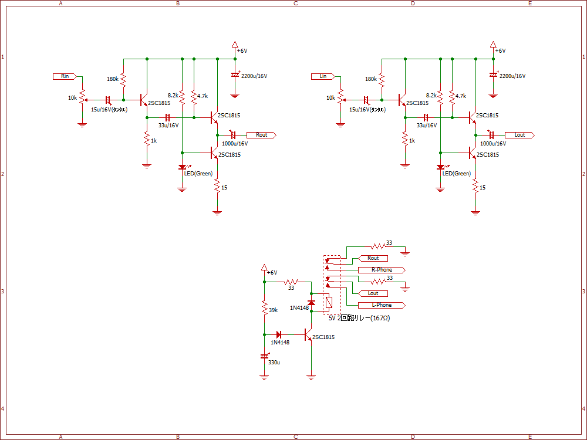
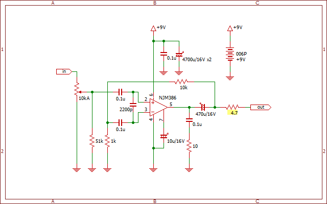
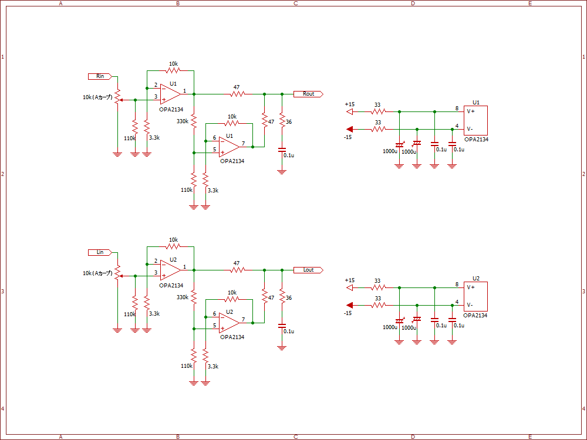
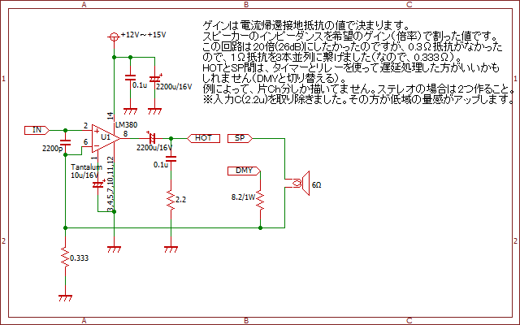
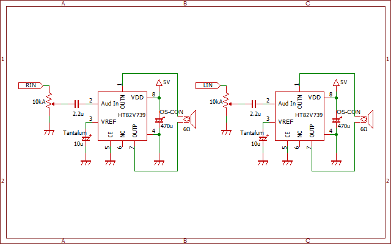
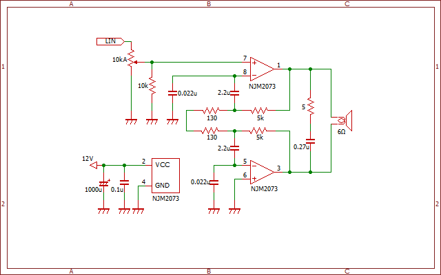
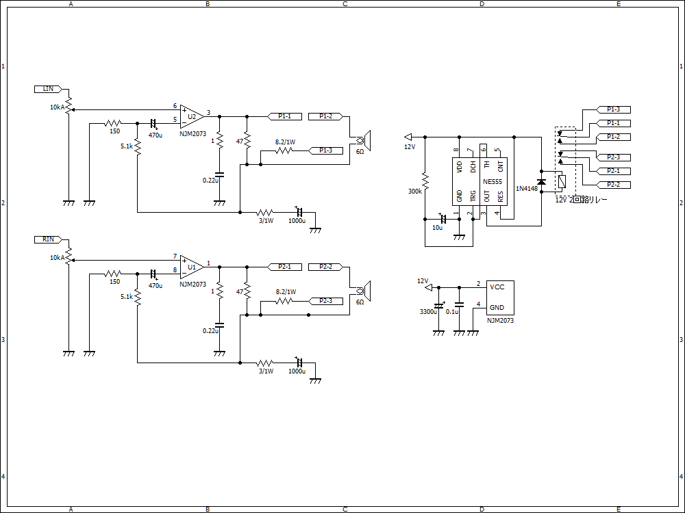
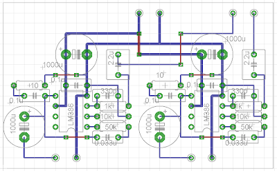

# 革命アンプシリーズ KiCad データ

ヘッドホンアンプ／パワーアンプ（「革命アンプ」シリーズほか）の KiCad プロジェクト一式です。
回路図（`.sch`）、基板（`.kicad_pcb`）、ガーバー／ドリル（`.g*`, `.drl`, `plot/`）、発注用 zip、参考資料 PDF を含みます。

- 作成ツール: KiCad 5 系（`.pro` / `.sch` 形式）
- 各フォルダの `*_mask.kicad_pcb` はマスク付き（基板発注用）レイアウト、`*_.kicad_pcb` は作業用レイアウトです。

## プロジェクト一覧

| フォルダ | 内容 | 主な IC / 素子 |
|---|---|---|
| [`1815_emitter`](1815_emitter) | 2SC1815 エミッタフォロワー ヘッドホンアンプ | 2SC1815 |
| [`386_head_phone2`](386_head_phone2) | NJM386 (LM386) を使ったノイズレスなヘッドホンアンプ | NJM386 / LM386 |
| [`386_kikan`](386_kikan) | LM386 電流負帰還アンプ | LM386 |
| [`lm386_kikan`](lm386_kikan) | LM386 電流負帰還の参考資料（PDF・図のみ） | LM386 |
| [`lm380_kikan`](lm380_kikan) | LM380 を使った電流帰還アンプ | LM380 |
| [`jj47`](jj47) | JJ47 式ヘッドホンアンプ | — |
| [`a47`](a47) | A47 ヘッドホンアンプ | — |
| [`ht82`](ht82) | HT82V739 アンプ | HT82V739 |
| [`njm2073_btl`](njm2073_btl) | NJM2073 BTL アンプ | NJM2073 |
| [`njm_2073_kikan`](njm_2073_kikan) | NJM2073 電流帰還アンプ | NJM2073 |
| [`lm3886_60w`](lm3886_60w) | LM3886 60W パワーアンプ | LM3886 |
| [`SB1-01-MAIN`](SB1-01-MAIN) | SwitchBoard PCB（`switchboard_pcb-ver*.zip` も同系統） | — |

### old/（初期の革命アンプなど）

| フォルダ | 内容 |
|---|---|
| [`old/kakumei_386`](old/kakumei_386) | LM386 革命アンプ |
| [`old/kakumei_380`](old/kakumei_380) | LM380 革命アンプ |
| [`old/kakumei_380_moto`](old/kakumei_380_moto) | LM380 革命アンプ（オリジナル版） |
| [`old/kakumei_380_type2`](old/kakumei_380_type2) | LM380 革命アンプ type2 |
| [`old/kakumei_380_type3`](old/kakumei_380_type3) | LM380 革命アンプ type3 |
| [`old/ayame`](old/ayame) | 工芸アンプ「あやめ」 |
| [`old/kansui_gw`](old/kansui_gw) | kansui_gw |
| [`old/usb_changer`](old/usb_changer) | USB チェンジャー |

### zip/

基板発注用のガーバー zip をまとめたフォルダです（`kakumei_386_005.zip`, `kakumei_380_003.zip` など）。

## 回路図・レイアウト画像

| | |
|---|---|
| 2SC1815 エミッタフォロワー  | NJM386 ヘッドホンアンプ  |
| JJ47 ヘッドホンアンプ  | LM380 電流帰還アンプ  |
| HT82V739  | NJM2073 BTL  |
| NJM2073 電流帰還  | LM386 革命アンプ  |

## 開き方

1. KiCad 5.x で各フォルダの `.pro` を開きます。
2. 一部のプロジェクトは独自ライブラリ（`*.lib`, `*.dcm`, `*.pretty`）をフォルダ内に同梱しています。
3. 基板を発注する場合は、各フォルダの `plot/` または `*.zip` のガーバーを使ってください。
